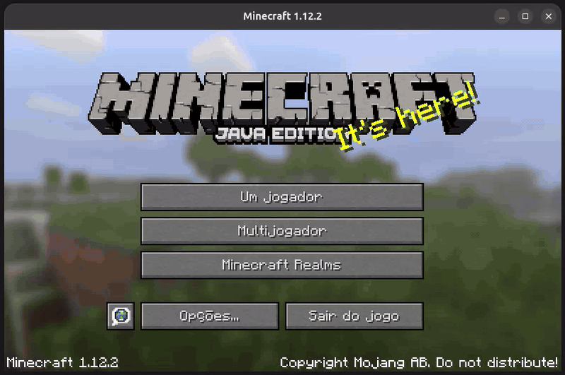

# Microcraft — A Minecraft Server (Probably the Worst One)

Projeto criado **apenas por desafio e diversão**: a ideia é pegar um MCU com recursos extremamente limitados de RAM e transformar em um mini servidor Minecraft, explorando o protocolo do jogo de forma minimalista.  

O repositório contém a implementação da API do Minecraft **1.12.2 (protocol 340)** em **duas versões**:

- **pc:** usada para testes rápidos, validação do protocolo e depuração.
- **microcraft:** versão específica para microcontroladores, desenvolvida para o MSP430G2553 utilizando o Code Composer Studio (CCS).

O servidor é implementado em **C**, suportando conexão básica do cliente e o início do carregamento do mundo.



---

## ✅ Features Implementadas

- Servidor TCP funcional  
- Implementação do Handshake do protocolo  
- Resposta de Status/Ping (lista de servidores)  
- MOTD exibido na lista de servidores  
- Login em modo offline  
- Envio de pacote Login Success  
- Transição para estado PLAY  
- Envio de pacote Join Game  
- Entrada inicial do jogador no mundo  
- Cliente chega à tela de carregamento de terreno  

---

## 🚧 TODO

Falta praticamente **toda a API do Minecraft**.  
A lista abaixo contém apenas alguns exemplos do que ainda precisa ser implementado:

- Implementar KeepAlive  
- Enviar chunk mínimo do mundo  
- Implementar movimentação básica do jogador  
- Chat básico  

---

## 🧠 MCU Utilizado — MSP430G2553

A versão embarcada do servidor roda no **MSP430G2553**, um microcontrolador propositalmente limitado:

- Arquitetura: MSP430 (16-bit)  
- Clock máximo: 16 MHz  
- Flash: **16 KB**  
- RAM: **512 bytes**  
- Alguns periféricos disponíveis:
  - SPI (usado na interface entre o MCU e o W5500)

> ⚠️ **Aviso:** Rodar qualquer coisa parecida com um servidor Minecraft nesse chip é **absurdo por definição**, e exatamente por isso faz parte do desafio.

### 🤷 Por que o MSP430G2553?

O MSP430G2553 não foi escolhido por mérito técnico, custo-benefício ou por ser a melhor opção para este projeto.  
Ele foi escolhido porque estava **jogado no fundo da minha gaveta**, acumulando poeira, e até então só tinha servido para projetos do tipo *pisca LED* ou algo igualmente pouco inspirador.

Para que ele finalmente fosse **útil para alguma coisa**, a decisão foi simples e questionável:  
rodar nele um servidor Minecraft.

Então, se você também tem esse LaunchPad esquecido por aí, talvez comprado em alguma matéria de microcontroladores da faculdade, este pode ser um projeto divertido para: rodar, quebrar, mexer e continuar evoluindo.

No meu caso, esse devkit foi um presente de um amigo querido. Fica aqui meu agradecimento pelo presente que, depois de tantos pisca LEDs, acabou virando um micro servidor Minecraft!

Essa é uma chance perfeita de usar esse chip para algo **mais interessante do que piscar um LED** (e passar um pouco de raiva no processo).

---

## 🔌 Hardware e Conexões — MSP430 + W5500

Como o MSP430G2553 **não possui Ethernet**, a comunicação de rede é feita usando o **W5500** (Ethernet SPI da Wiznet).

### Componentes principais

- MSP430G2553 LaunchPad Development Kit
- Modulo W5500 (Ethernet via SPI)  
- Fonte externa 3.3V (para o W5500)  

<!--  -->

### Interface MSP430 ↔ W5500

- SPI (MOSI, MISO, SCK)  
- CS dedicado  
- RESET do W5500 controlado por GPIO  

A implementação embarcada consulta o W5500 por **polling**, usando a interface **USCI_B0**, SPI modo 0, MSB primeiro e clock de **SMCLK/4** (250 kHz com SMCLK de 1 MHz).

### 📌 Mapeamento de Pinos — W5500 ↔ MCU (MSP430G2553)

| Sinal no W5500 | Conexão | Função / observação |
| --- | --- | --- |
| MOSI | **P1.7 / UCB0SIMO** | Dados do MSP430 → W5500 |
| MISO | **P1.6 / UCB0SOMI** | Dados do W5500 → MSP430 |
| SCK | **P1.5 / UCB0CLK** | Clock SPI gerado pelo MSP430 |
| CS / SCSn | **P1.4** | Seleção do chip, ativa em nível baixo |
| RST / RSTn | **P2.0** | Reset controlado pelo MCU, ativo em nível baixo |
| 3V3 | **Fonte externa de 3,3 V** | Alimentação do W5500; não conectar 5 V neste pino |
| GND | **GND do MSP430 e da fonte externa** | Referência comum entre os componentes |

Os nomes P1.x/P2.x identificam as portas do MCU.

### ⚠️ Observações Importantes

- **O W5500 foi escolhido propositalmente** por implementar toda a stack TCP/IP em hardware, permitindo:
  - Não ser necessário implementar TCP/IP em software;
  - Economizar uma quantidade significativa de RAM;
  - Trabalhar apenas com sockets, buffers e estados simples.
- O W5500 **opera exclusivamente em 3.3V**.
- Utilize **jumpers de boa qualidade e o mais curtos possível**.

> Durante os testes, foram observados **erros de bytes na comunicação SPI** causados por jumpers "longos" e/ou de baixa qualidade.

---

## ▶️ Build e Execução (Versão PC)

A versão para PC existe exclusivamente para **testes, validação do protocolo e depuração**.  
Ela facilita o desenvolvimento antes de portar qualquer funcionalidade para o MCU.

### Requisitos

- GCC
- Make
- Sistema Linux ou WSL

### Build

Na pasta da implementação para PC:

```bash
make
```

O executável será gerado em:

```bash
./build/server
```

### Execução

Execute o servidor com:

```bash
make run
```

ou,

```bash
./build/server
```

Por padrão, o servidor escuta na **porta TCP padrão do Minecraft (25565)**, definida diretamente no código.

⚠️ Esta versão não é um servidor Minecraft completo.
Ela implementa apenas partes mínimas do protocolo.

---

## ▶️ Build e Execução (Versão MCU)

A implementação embarcada é distribuída como um **projeto completo do CCS**, em C, com acesso direto aos registradores do MSP430G2553. Foi utilizado o **Code Composer Studio (CCS) versão `21.0.1.10__1.12.1`**. A pasta do projeto CCS é denominada `microcraft/`.

### Como funciona

`app_main_run()` inicializa o SPI e o W5500, configura a rede e mantém o servidor em polling. O **socket 0** atende um cliente por vez; os outros sockets não são utilizados. O W5500 cuida do TCP/IP e fornece **16 KB para RX e 16 KB para TX**, sem consumir essa memória no MSP430.

O parser processa os dados byte a byte, sem guardar pacotes inteiros em RAM. Nome do jogador e payload de ping compartilham um buffer de **16 bytes**. As respostas incluem status/pong, login com UUID fixo, Join Game e posição inicial `(0, 70, 0)`. No estado PLAY, os pacotes recebidos são descartados; ainda não há chunks nem KeepAlive.

| Arquivos na raiz do projeto CCS | Responsabilidade |
| --- | --- |
| `app_main.c/.h`, `app_config.h` | Loop da aplicação, recuperação de erros e configuração de rede |
| `mc_server.c/.h`, `mc_config.h` | Parser incremental e parâmetros do protocolo |
| `mc_packets.c/.h` | Montagem e envio das respostas Minecraft |
| `w5500.c/.h`, `w5500_registers.h` | Driver, registradores e operações TCP |
| `w5500_msp_config.h` | Pinos, tempos de reset e referência de clock para atrasos |
| `bsp_spi`, `bsp_w5500`, `bsp_delay` (`.c/.h`) | Acesso ao hardware e temporização |

### Configuração de rede

Antes de compilar, ajuste **`app_config.h`**, na raiz do projeto CCS, para a sua rede. A configuração é estática, sem DHCP:

```c
#define APP_MAC_ADDRESS       {0x00, 0x12, 0x34, 0x56, 0x78, 0x90}
#define APP_IP_ADDRESS        {192, 168, 1, 111}
#define APP_SUBNET_MASK       {255, 255, 255, 0}
#define APP_GATEWAY_ADDRESS   {192, 168, 1, 1}
#define APP_TCP_PORT          25565
```

- **IP:** escolha um endereço livre na mesma sub-rede do computador que executará o Minecraft. Reserve-o no roteador ou escolha um endereço fora da faixa DHCP para evitar conflitos.
- **Máscara:** use a máscara da sua rede local.
- **Gateway:** informe o IP do seu roteador.
- **MAC:** deve ser único na rede e unicast. Para um endereço atribuído manualmente, prefira um MAC local começando por `0x02`.
- **Porta:** mantenha `25565` ou informe a porta escolhida ao conectar no jogo.

A descrição exibida na lista de servidores (MOTD) pode ser alterada em **`mc_config.h`**, na macro `MC_STATUS_JSON`. Após mudar essas configurações, recompile e grave o firmware novamente.

### Compilação no CCS

1. Importe no CCS o projeto fornecido no repositório, selecionando a pasta que contém os arquivos da IDE e da implementação (`microcraft/`).
2. Ajuste os parâmetros de rede em `app_config.h`.
3. Faça o build do projeto para gerar **`microcraft.out`**.

### Gravação e execução

> **CCS + Ubuntu 26:** no ambiente utilizado, a gravação da Flash pelo CCS versão `21.0.1.10__1.12.1` não está funcionando. O build foi feito no CCS e a gravação pelo **MSPDebug**, usando o driver `rf2500` do LaunchPad.

Com o MSPDebug instalado e o LaunchPad conectado por USB, execute na pasta que contém o arquivo gerado (geralmente na raiz do projeto CCS dentro da pasta Debug):

```bash
mspdebug rf2500 "prog microcraft.out"
```

Para **somente apagar a Flash principal**, use:

```bash
mspdebug rf2500 "erase"
```

Esse apagamento remove o programa; não é necessário apagar separadamente antes de usar `prog`.

Depois de gravar, reinicie a placa para executar o firmware. Conecte o W5500 à rede por Ethernet e, no **Minecraft Java 1.12.2**, abra **Multiplayer → Direct Connect** e informe:

```text
192.168.1.111:25565
```

Substitua pelo IP e pela porta configurados em `app_config.h`. O computador e o servidor devem ter conectividade na rede local. A conexão chega à etapa inicial de carregamento, conforme as funcionalidades implementadas; ainda não há um mundo jogável.

---

## 🔗 Links Úteis
<!-- TODO -->
<!-- A implementação da API do Minecraft (versão **340**, protocolo **1.12.2**) foi baseada na documentação disponível em https://XXXXXX. -->
